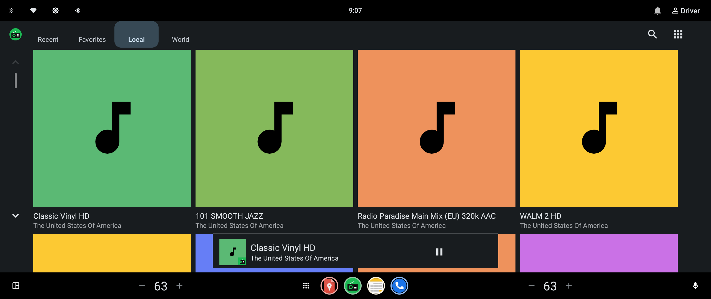
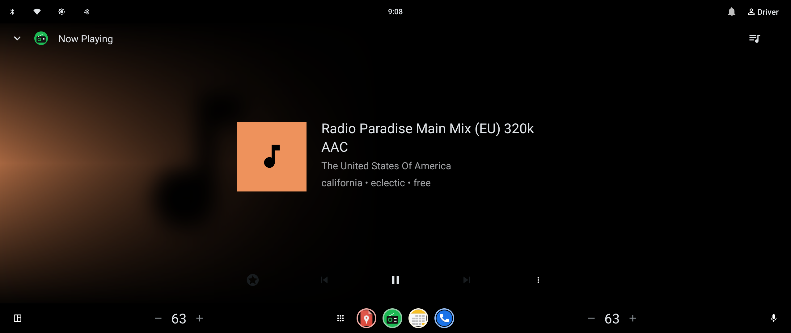
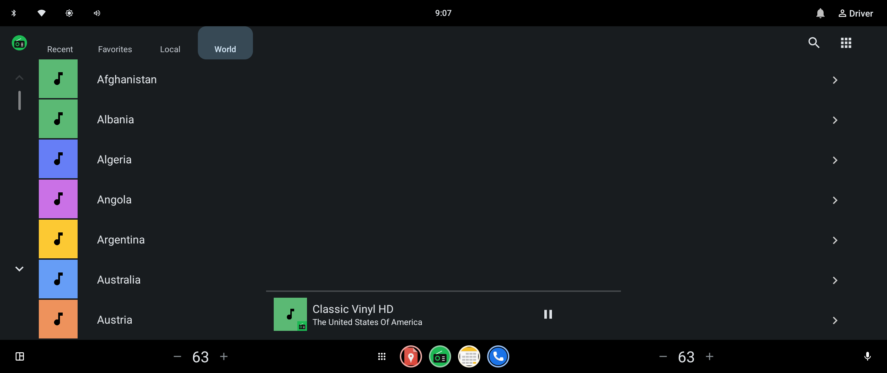
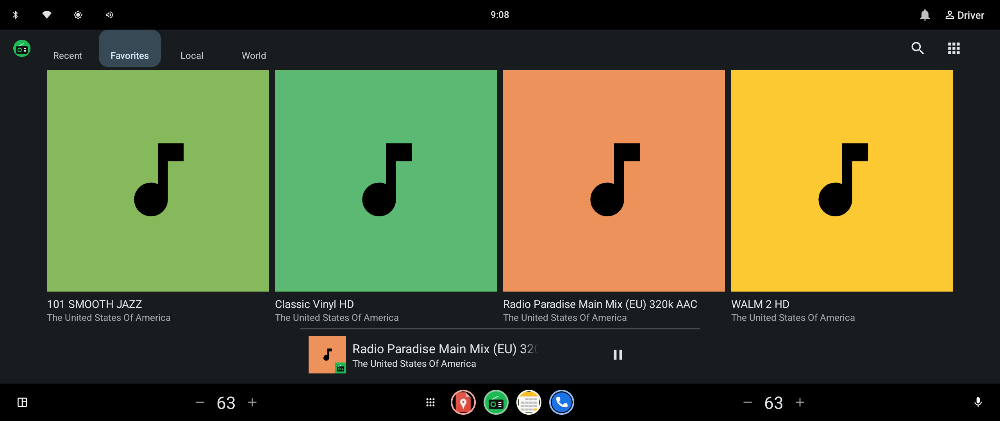
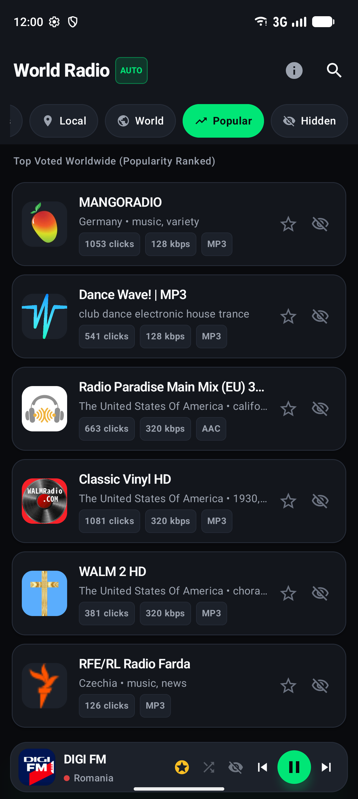
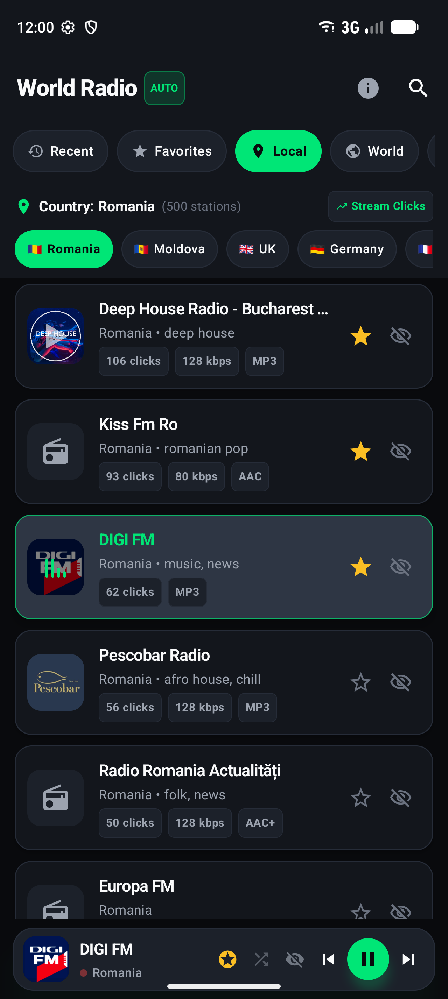
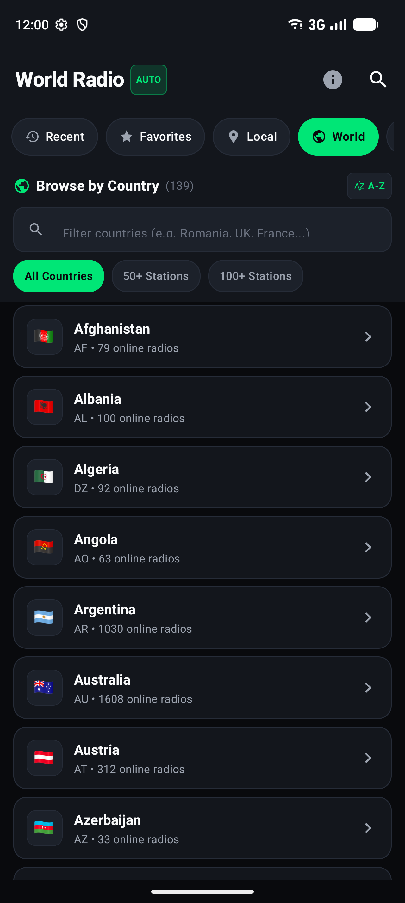
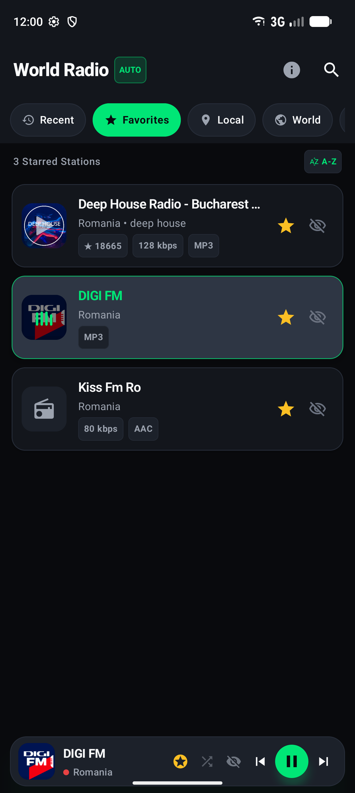

# World Radio Auto 📻🚗

An Android online radio streaming application optimized for **Android Auto** and mobile devices, connecting users to over 45,000 live radio stations worldwide powered by the [Radio Browser API](https://www.radio-browser.info/).

---

## 📸 Screenshots

### 🚗 Car Display (Android Auto / Automotive Head Unit)

| Local Stations Grid | Now Playing |
| :---: | :---: |
|  |  |

| World — Browse by Country | Favorites |
| :---: | :---: |
|  |  |

### 📱 Mobile App

| Popular Stations | Live Playback & Local | Browse by Country | Favorites |
| :---: | :---: | :---: | :---: |
|  |  |  |  |

---

## 🌟 Key Features

- **Optimized for Android Auto**: Fully compliant with Google's Automotive Media App standards using modern **AndroidX Media3 (`MediaLibraryService`)**.
- **Car Head-Unit Navigation**: The top-level root hierarchy exposes 6 dedicated categories (Android Auto shows the primary tabs and automatically places additional categories cleanly into its overflow/More menu):
  1. 🕒 **Recent** *(First Tab)*: Quickly resume recently played radio stations.
  2. ⭐ **Favorites** *(Second Tab)*: Instant access to starred stations with one tap from the dashboard.
  3. 📍 **Local**: Live broadcast stations detected for your locale/country.
  4. 🌍 **World / Filter by Country**: Browse global stations organized by country and region.
  5. 🔥 **Popular**: Highest voted stations worldwide.
  6. 🚫 **Hidden**: Stations explicitly hidden from all normal tabs and queues.
- **In-Car Controls**:
  - Head-unit custom action buttons to **Favorite** (`COMMAND_TOGGLE_FAVORITE`), **Hide** (`COMMAND_TOGGLE_HIDE`), and **Shuffle** (`COMMAND_TOGGLE_SHUFFLE`) without leaving the media screen.
  - Ignition / Bluetooth reconnect playback resumption (`onPlaybackResumption`).
  - Audio focus & noise handling (smooth pause when disconnected from car Bluetooth or on GPS/call interrupts).
- **Mobile Experience**:
  - Built with Jetpack Compose & Material 3.
  - Floating MiniPlayer with live buffer indicator, waveform animation, and quick controls.
  - Search any radio station, genre, or tag.
  - Offline cache and favorites persistence via Room Database.

---

## 🛠️ Tech Stack & Architecture

- **Language**: Kotlin 2.0+ (Coroutines & StateFlow)
- **Audio & Automotive Engine**: AndroidX Media3 1.5.1
  - `MediaLibraryService` & `MediaLibrarySession`
  - `ExoPlayer` with HLS, AAC, MP3, Icecast & Shoutcast live streams
  - `OkHttpDataSource`
- **UI Framework**: Jetpack Compose with Material 3 (dark automotive theme)
- **Local Persistence**: AndroidX Room (`StationDao`, `RadioDatabase`)
- **Networking**: Retrofit 2 + Moshi + OkHttp
- **Image Loading**: Coil 2 for remote station favicons and logos

---

## 📁 Project Structure

```text
world-radio-auto/
├── .github/workflows/unit-tests.yml                  # GitHub Actions CI workflow (JVM unit tests)
├── app/
│   ├── src/
│   │   ├── main/
│   │   │   ├── AndroidManifest.xml                   # Declares MediaLibraryService & Auto metadata
│   │   │   ├── res/
│   │   │   │   └── xml/automotive_app_desc.xml       # Declares media template capability for Android Auto
│   │   │   └── java/com/worldradio/auto/
│   │   │       ├── RadioApp.kt                       # App singleton & dependency setup
│   │   │       ├── data/
│   │   │       │   ├── model/                        # Station & CuratedStations models
│   │   │       │   ├── remote/                       # Radio Browser API Retrofit client
│   │   │       │   ├── local/                        # Room Entity, DAO, and Database
│   │   │       │   └── repository/                   # Unified RadioRepository
│   │   │       ├── media/
│   │   │       │   ├── MediaItemConverter.kt         # Bridges domain models with Media3 MediaItems
│   │   │       │   ├── PlaylistQueueHelper.kt        # Queue filtering & hidden station exclusion
│   │   │       │   └── RadioMediaService.kt          # MediaLibraryService handling Android Auto IPC
│   │   │       ├── receiver/
│   │   │       │   └── BootReceiver.kt               # Awakens package on boot for Android Auto discovery
│   │   │       ├── util/
│   │   │       │   ├── CountryDetector.kt            # Locale, timezone & manual country detection
│   │   │       │   └── DiagnosticLogger.kt           # In-app playback & API diagnostics log
│   │   │       └── ui/
│   │   │           ├── MainActivity.kt               # Mobile edge-to-edge Compose activity
│   │   │           ├── theme/                        # Dark automotive theme & palette
│   │   │           ├── components/                   # MiniPlayer, StationListItem, DiagnosticsDialog
│   │   │           ├── screens/                      # Recent, Favorites, Local, World, Popular, Hidden, HomeScreen
│   │   │           └── viewmodel/                    # RadioViewModel managing playback & media browsing
│   │   └── test/java/com/worldradio/auto/
│   │       ├── data/
│   │       │   ├── local/StationEntityAndMigrationTest.kt # Entity mapping, DAO filters & Room v1->v2 migration
│   │       │   ├── remote/FakeRadioBrowserApi.kt          # In-memory fake API client for deterministic tests
│   │       │   └── repository/RadioRepositoryTest.kt      # Popular/Local/Country/Search & flag persistence tests
│   │       ├── media/
│   │       │   ├── MediaItemConverterTest.kt              # Media3 IDs, 6 root tabs & metadata conversion
│   │       │   └── PlaylistQueueHelperTest.kt             # Queue filtering, hidden exclusion & suggestions
│   │       ├── ui/viewmodel/RadioViewModelTest.kt         # Reactive StateFlows & playback guard tests
│   │       └── util/UtilsAndModelsTest.kt                 # Country flags, location formatting & timezone fallback
│   └── build.gradle.kts
├── gradle/
│   ├── libs.versions.toml                            # Modern Gradle Version Catalog
│   └── wrapper/                                      # Gradle 8.13 wrapper
├── local.properties.example                          # Template for local Android SDK path
├── LICENSE
└── README.md
```

---

## 🚘 How Android Auto Integrates with This App

In Android Auto, media apps do not draw custom arbitrary UI on the car screen; instead, they integrate with the car's native automotive media template via **AndroidX Media3**:

1. **Root Tabs**:
   In `RadioMediaService.kt`, `onGetChildren(parentId = "[ROOT]")` returns 6 browsable `MediaItem`s (Android Auto renders the primary tabs directly and routes extra categories into its overflow/More tab):
   - `[TAB_RECENT]`
   - `[TAB_FAVORITES]`
   - `[TAB_LOCAL]`
   - `[TAB_WORLD]`
   - `[TAB_POPULAR]`
   - `[TAB_HIDDEN]`
2. **Deep Browsing**:
   Selecting **World** returns country folders. Tapping a country returns playable station streams for that country.
3. **In-Car Actions**:
   `COMMAND_TOGGLE_FAVORITE`, `COMMAND_TOGGLE_HIDE`, and `COMMAND_TOGGLE_SHUFFLE` are registered as custom actions in `MediaLibrarySession` on the car display.

---

## 🚀 Getting Started

### Prerequisites
- **Android Studio** (Koala, Ladybug, or newer) or **JDK 17 / 21** with the **Android SDK** (`compileSdk = 35`, `minSdk = 26`).

### Setup & Build
1. Clone the repository:
   ```bash
   git clone https://github.com/claudiuroata/world-radio-auto.git
   cd world-radio-auto
   ```
2. Configure your local Android SDK path (or open the project in Android Studio to generate `local.properties` automatically):
   ```bash
   cp local.properties.example local.properties
   # Edit local.properties and set sdk.dir to your Android SDK location
   ```
3. Build the debug APK using the Gradle wrapper:
   ```bash
   ./gradlew assembleDebug
   ```
   *(On Windows PowerShell: `.\gradlew.bat assembleDebug`)*

   The compiled APK will be generated at `app/build/outputs/apk/debug/app-debug.apk`.

---

## ✅ Running Unit Tests

Run all JVM and Robolectric unit tests across every layer using the Gradle wrapper:

```bash
./gradlew testDebugUnitTest
```

Included test suites (30 unit tests total):
- `StationEntityAndMigrationTest` — Entity/domain mapping, tag parsing, DAO hidden-station filtering, and Room `MIGRATION_1_2` verification.
- `RadioRepositoryTest` — Popular/Local/Country/Search API queries, curated station fallbacks, and Favorite/Hidden flag persistence.
- `MediaItemConverterTest` — Media3 compound `mediaId` encoding/decoding, 6 top-level Android Auto root tabs, and station metadata conversion.
- `PlaylistQueueHelperTest` — Playback queue filtering, duplicate/hidden station removal, and suggested station ordering.
- `RadioViewModelTest` — Reactive StateFlows for Local, Popular, Country, Search, and Hidden station toggling.
- `UtilsAndModelsTest` — Country code flag emoji conversion, location display formatting, and `CountryDetector` override/timezone fallback logic.

---

## 🧪 Testing with Android Auto Desktop Head Unit (DHU)

To test the Android Auto interface on your development machine:

1. Enable Developer Options in the **Android Auto app** on your test phone:
   - Open Android Auto Settings -> Tap "Version" 10 times -> Enable "Start head unit server".
2. Forward the port using ADB:
   ```bash
   adb forward tcp:5277 tcp:5277
   ```
3. Launch the Android Auto Desktop Head Unit (DHU) from Android SDK:
   ```bash
   %LOCALAPPDATA%\Android\Sdk\extras\google\auto\desktop-head-unit.exe
   ```
4. **World Radio Auto** will appear in the media drawer on the DHU display!

---

## 🔒 Privacy & Permissions

- **Local Preferences & No Tracking**: Favorites, recent playback history, and hidden station preferences are stored 100% locally on-device in the Room SQLite database (`RadioDatabase`). World Radio Auto contains zero analytics, telemetry, user accounts, or ad SDKs.
- **External Network Queries**: Live station directories and searches are fetched directly from the public community [Radio Browser API](https://www.radio-browser.info/), and audio playback connects directly to the selected broadcaster's stream URL (`usesCleartextTraffic="true"` is enabled in `AndroidManifest.xml` because many legacy Icecast/Shoutcast internet radio streams broadcast over plain `http://`).

| Permission (`AndroidManifest.xml`) | Why It Is Needed |
| :--- | :--- |
| `INTERNET` | Fetch live station directories from the Radio Browser API and stream internet radio audio + station favicons. |
| `ACCESS_NETWORK_STATE` | Check connectivity state before streaming or retrying station lookups. |
| `FOREGROUND_SERVICE` / `FOREGROUND_SERVICE_MEDIA_PLAYBACK` | Keep live radio playback running smoothly in the background and on Android Auto head units. |
| `WAKE_LOCK` | Prevent CPU sleep from interrupting active audio streaming buffers. |
| `POST_NOTIFICATIONS` | Show active media playback controls in the notification shade on Android 13+. |
| `RECEIVE_BOOT_COMPLETED` | Awaken the app package cleanly after reboot/update so Android Auto can discover the media service immediately. |
| `REQUEST_IGNORE_BATTERY_OPTIMIZATIONS` | Optional user-prompted exemption so OS battery savers do not kill long-running background radio streams. |

---

## 📦 Dependencies, External APIs & Third-Party Licenses

World Radio Auto builds against the following open-source libraries via Gradle (`gradle/libs.versions.toml`, `app/build.gradle.kts`) and includes the Gradle Wrapper (`8.13`):

| Dependency / Service | Scope | Purpose | License |
| :--- | :--- | :--- | :--- |
| **AndroidX Core, Lifecycle, Activity & Navigation** (`core-ktx:1.15.0`, `lifecycle-*:2.8.7`, `activity-compose:1.9.3`, `navigation-compose:2.8.4`) | Runtime | Core Android APIs, Compose integration & ViewModels | Apache License 2.0 |
| **Jetpack Compose & Material 3** (`compose-bom:2024.11.00`, `material3`, `material-icons-extended:1.7.5`) | Runtime | Declarative mobile UI & Material Icons | Apache License 2.0 |
| **AndroidX Media3** (`exoplayer`, `exoplayer-hls`, `session`, `datasource-okhttp`, `ui:1.5.1`) | Runtime | Live stream playback & Android Auto `MediaLibraryService` | Apache License 2.0 |
| **AndroidX Room** (`room-runtime`, `room-ktx`, `room-compiler:2.6.1`) | Runtime | Local SQLite persistence for Favorites, Recents & Hidden stations | Apache License 2.0 |
| **Retrofit 2, OkHttp 4 & Moshi** (`retrofit:2.11.0`, `okhttp:4.12.0`, `moshi-kotlin:1.15.2`) | Runtime | Radio Browser API HTTP client & JSON deserialization | Apache License 2.0 |
| **Coil Compose** (`coil-compose:2.7.0`) | Runtime | Asynchronous station favicon/logo loading | Apache License 2.0 |
| **Kotlin Coroutines** (`kotlinx-coroutines-android`, `kotlinx-coroutines-guava:1.9.0`) | Runtime | Asynchronous concurrency & Media3 `ListenableFuture` bridging | Apache License 2.0 |
| **Gradle Wrapper (`8.13`)** (`gradlew`, `gradlew.bat`, `gradle-wrapper.jar`) | Build Tooling | Cross-platform Gradle build wrapper | Apache License 2.0 |
| **JUnit 4** (`junit:4.13.2`) | Unit Tests Only | Local JVM unit testing framework | Eclipse Public License 1.0 |
| **Robolectric** (`robolectric:4.13`) | Unit Tests Only | Android framework simulation for local JVM tests | MIT License |
| **AndroidX Test, Room Testing & Coroutines Test** (`test-core:1.6.1`, `arch-core:2.2.0`, `room-testing:2.6.1`, `coroutines-test:1.9.0`) | Unit Tests Only | Database migration, LiveData/Arch & coroutine test utilities | Apache License 2.0 |
| **Radio Browser API** (`radio-browser.info`) | External API | Community-maintained open directory of live internet radio stations | Public Domain / GPLv3 community directory |

---

## 📄 License

Copyright (c) 2026 Claudiu Roata

This project is licensed under the **MIT License** — see the [LICENSE](LICENSE) file for full details.
